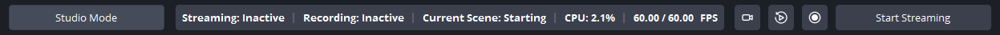

# Dynamite Toolbar

### This plugin makes it easy to access common OBS controls in a toolbar-like widget, without the need of the OBS Controls Dock!

&nbsp;
## Features
- Stream, Record, Studio Mode, Virtual Camera & Replay Buffer buttons.
- Undockable, with top or bottom window placement.
- Status display, with stream status, recording status, active scene, CPU usage, FPS and dropped frames.
- Responsive!
- Configurable via Tools -> Dynamite Toolbar Settings.
- Tested on Windows 11 with OBS 32.1.1.

&nbsp;
## Prerequisites
 
| Tool | Version | Notes |
|---|---|---|
| CMake | 4.2+ | |
| .NET SDK | 10.0+ | Required for the C# NativeAOT plugin |
| Visual Studio | 2026 | Windows only — Desktop C++ workload required |
| Xcode | 16.1+ | macOS only |
| Ninja | Any | Linux only |
 
&nbsp;
## Building
 
Dependencies (OBS sources, Qt6, obs-deps) are fetched automatically by CMake on first configure.
 
### Windows
 
```powershell
cmake --preset windows-x64
cmake --build --preset windows-x64
```
 
### macOS
 
```zsh
cmake --preset macos
cmake --build --preset macos
```
 
### Linux (Ubuntu)
 
```bash
cmake --preset ubuntu-x86_64
cmake --build --preset ubuntu-x86_64
```
 
&nbsp;
## Installing
 
Pass the OBS plugins directory as the install prefix. CMake will place the DLLs into `obs-plugins/64bit` and locale files into `data/obs-plugins/dynamiteandy.dynamite-toolbar/locale` automatically.
 
### Windows
 
```powershell
cmake --install build_x64 --config RelWithDebInfo --prefix "C:\Program Files\obs-studio"
```
 
### macOS
 
```zsh
cmake --install build_macos --config RelWithDebInfo --prefix "/Applications/OBS.app/Contents"
```
 
### Linux
 
```bash
cmake --install build_x86_64 --prefix ~/.config/obs-studio/plugins
```
 
&nbsp;
## Running Tests
 
Tests are opt-in. Pass `-DENABLE_TESTS=ON` at configure time to include both the C++ (GTest) and C# (NUnit) test suites.
 
### Windows
 
```powershell
cmake --preset windows-x64 -DENABLE_TESTS=ON
cmake --build --preset windows-x64
ctest --test-dir build_x64 --build-config RelWithDebInfo --output-on-failure
```
 
### macOS
 
```zsh
cmake --preset macos -DENABLE_TESTS=ON
cmake --build --preset macos
ctest --test-dir build_macos --build-config RelWithDebInfo --output-on-failure
```
 
### Linux
 
```bash
cmake --preset ubuntu-x86_64 -DENABLE_TESTS=ON
cmake --build --preset ubuntu-x86_64
ctest --test-dir build_x86_64 --build-config RelWithDebInfo --output-on-failure
```
 
To run only the C++ tests: `ctest ... -L gtest`  
To run only the C# tests: `ctest ... -L dotnet`

&nbsp;
## Special Thanks To:

- [obsproject - obs-plugintemplate](https://github.com/obsproject/obs-plugintemplate) - The boilerplate this repository,
- [kostya9 - NetObsBindings](https://github.com/kostya9/NetObsBindings) - The backbone of this repository,
- [YorVeX - ObsCSharpExample](https://github.com/YorVeX/ObsCSharpExample) - The example from this repository was very helpful!
- [MisutaaAsriel - obs-toolbar](https://github.com/MisutaaAsriel/obs-toolbar) - The original design, implementation and source of this project. Special thanks for giving me permission to continue this project in my own way.